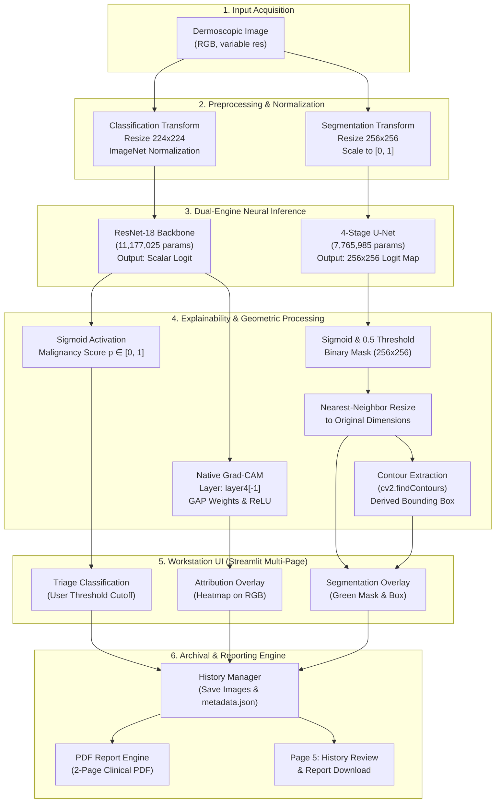
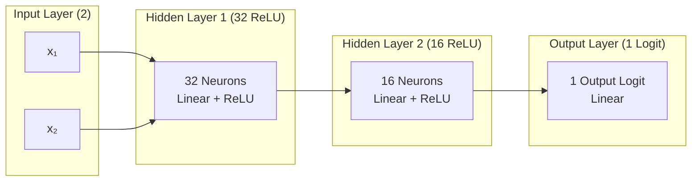

# Comprehensive Deep Learning Experiments & Technical Evaluation Report

**Academic Workstation**: Medical Imaging Triage and Lesion Analysis System  
**Academic Context**: B.Tech Semester V — Deep Learning Evaluation & Technical Viva Defense  
**Evaluation Format**: 8-Minute Technical Demonstration & 4-Minute Viva Defense  
**Primary Deliverables**: Dual-Engine Clinical Triage Models (ResNet-18 & U-Net), Explainability Engine (Grad-CAM), and Foundational Optimization Laboratory (SimpleMLP)  
**Repository Working Directory**: `c:\Users\Dell\Desktop\Medical-Imaging-Triage`  

---

## 1. Project Overview & Clinical System Architecture

### 1.1 Problem Statement & Clinical Motivation
Cutaneous melanoma accounts for the vast majority of skin cancer mortalities despite comprising only a minority of total skin cancer diagnoses. Early clinical detection dramatically improves 5-year survival rates (exceeding 98% for localized lesions, dropping below 30% for distant metastases). Dermatologists rely heavily on **dermoscopy** (epiluminescence microscopy) to inspect pigment patterns, vascular structures, and architectural borders without invasive surgical excision.

However, dermatological triage presents two fundamental challenges:
1. **Clinical Bottlenecks**: The scarcity of certified dermatologists leads to referral backlogs in primary care environments.
2. **Inter-Observer Variability & Cognitive Fatigue**: Visual inspection of subtle atypical lesions is prone to diagnostic variance, often leading to either missed malignant cases (false negatives) or excessive benign lesion biopsies (false positives).

This project designs and implements an **academic deep learning workstation** combining automated classification triage, lesion boundary segmentation, visual saliency explainability, and an empirical neural network optimization laboratory.

> [!IMPORTANT]
> **Academic & Experimental Scope Notice**:  
> This workstation is developed strictly as an academic research and educational prototype. It is **not** a certified Software as a Medical Device (SaMD) and has not received regulatory clearance (e.g., FDA 510(k), CE mark). Predictions, segmentations, and heatmaps generated by this software must not be used to direct clinical interventions or replace clinical judgement.

---

### 1.2 System Objectives
The workstation is engineered to fulfill four distinct technical objectives:
1. **Lesion Classification Triage**: Provide a rapid screening score using a Deep Residual Network (ResNet-18) to prioritize high-risk lesions.
2. **Pixel-Level Lesion Segmentation**: Delineate precise lesion boundaries via a convolutional U-Net to assist in morphological measurement.
3. **Transparent Model Explainability**: Attribute model decisions using native PyTorch Gradient-Weighted Class Activation Mapping (Grad-CAM) to verify that inference attends to pathological features rather than imaging artifacts.
4. **Empirical Optimization Foundations**: Provide a standalone, controlled neural network optimization laboratory on a calibrated 641-parameter Multilayer Perceptron (SimpleMLP) to examine gradient descent variants, learning rate dynamics, weight initialization, and regularization.
5. **Permanent Analysis Archival & Clinical PDF Reporting**: Persist complete multi-modal analysis sessions (images, masks, heatmaps, bounding boxes, and metadata) in structured archives (`results/analysis_history/`) and compile publication-grade 2-page A4 clinical reports.

---

### 1.3 End-to-End System Architecture & Pipeline Workflow



---

### 1.4 Technology Stack & Software Dependencies

The technical stack is built on modern scientific Python libraries:
* **Deep Learning Framework**: `torch` (PyTorch 2.15.0+cpu), `torchvision` (0.16.0+cpu).
* **Computer Vision & Image Processing**: `opencv-python-headless` (OpenCV 4.8+), `Pillow` (PIL 10.0+).
* **Workstation UI & State Management**: `streamlit` (1.28+) with multi-page structure and `st.session_state` caching.
* **Interactive Scientific Data Visualization**: `plotly` (5.18+) for dynamic convergence curves and contour manifolds.
* **Numerical Mathematics & Data Manipulation**: `numpy` (1.24+), `pandas` (2.1+), `scipy`, `scikit-learn`.

---

### 1.5 Hardware Execution Environment & Detection

The workstation was developed and evaluated on a mobile workstation environment:
* **Host Processor (CPU)**: 7th Generation Intel Core i5 / Intel HD Graphics 620 architecture.
* **Graphics Acceleration (GPU)**: Intel integrated graphics; no dedicated CUDA-enabled hardware available.
* **Hardware Detection Architecture (`app/components/device.py`)**:
  ```python
  def get_device() -> torch.device:
      if torch.cuda.is_available():
          return torch.device("cuda")
      return torch.device("cpu")
  ```
  The pipeline transparently routes tensors to `torch.device("cpu")`. On CPU, thread allocations are managed through standard PyTorch intra-op primitives. All ResNet-18 forward passes, U-Net segmentations, and Grad-CAM backpropagation cycles execute deterministically in under 1.2 seconds per image on this CPU architecture.

---

## 2. Dataset Documentation: ISIC / ISBI 2016 Part 1 Benchmark

### 2.1 Provenance, Licensing & Data Organization
* **Source**: International Skin Imaging Collaboration (ISIC) / IEEE International Symposium on Biomedical Imaging (ISBI) 2016 Challenge: *Part 1 — Lesion Classification and Segmentation*. Official landing pages:
  - [ISIC Challenge Datasets](https://challenge.isic-archive.com/data/)
  - [ISIC 2016 Task 1 Benchmark](https://challenge.isic-archive.com/landing/2016/37/)
* **Licensing**: **Creative Commons Zero 1.0 Universal (CC-0 / Public Domain Dedication)**.  
  As officially indexed in the ISIC Challenge archives, the 2016 Task 1 training images and ground-truth segmentation masks are distributed under CC-0 (Public Domain). They do **not** use the CC BY-NC 4.0 license that was introduced in subsequent challenge editions (e.g., ISIC 2018 / 2019).
* **Cohort Size**: 900 dermoscopic records with paired ground truth diagnostic annotations (`benign` or `malignant`) and expert-annotated binary lesion masks.
* **Storage Structure**: Split metadata is stored in `data/splits/` as `train.csv`, `validation.csv`, and `test.csv`.

---

### 2.2 Cohort Partitioning & Stratification

The 900-image training cohort was partitioned into an internal **70% / 15% / 15%** split using a pseudo-random seed of `42`:

| Partition | CSV Filename | Total Images | Benign Count ($y=0$) | Benign Ratio | Malignant Count ($y=1$) | Malignant Ratio | Imbalance Ratio |
| :--- | :--- | :--- | :--- | :--- | :--- | :--- | :--- |
| **Training** | `train.csv` | 630 | 509 | 80.79% | 121 | 19.21% | 4.21 : 1 |
| **Validation** | `validation.csv` | 135 | 109 | 80.74% | 26 | 19.26% | 4.19 : 1 |
| **Internal Test Split** | `test.csv` | 135 | 109 | 80.74% | 26 | 19.26% | 4.19 : 1 |
| **Total Cohort** | — | **900** | **727** | **80.78%** | **173** | **19.22%** | **4.20 : 1** |

---

### 2.3 Critical Methodological Dataset Limitations & Test Split Clarification
1. **Internal Held-Out Test Split vs. Official ISIC 2016 Challenge Test Set**:  
   > [!IMPORTANT]
   > The 135-image test split (`data/splits/test.csv`) evaluated in this project is an **internal, image-level held-out partition derived from the 900-image ISIC 2016 training cohort** (15% held out). It is **not** the official ISIC 2016 external challenge test set of 379 images. All reported classification metrics, sensitivity/specificity values, and evaluation curves refer strictly to this internal 135-image held-out partition.
2. **Image-Level vs. Patient-Level Splitting**:  
   The partition was conducted strictly at the **image level**. Patient identifiers (e.g., `patient_id`) were not provided or verified in the ISBI 2016 challenge metadata. Consequently, multiple images belonging to the same subject could potentially reside across train, validation, and test splits. **We explicitly do not claim patient-level leakage prevention.**
3. **Duplicate Image Hashing**:  
   No cryptographic perceptual hashing (e.g., MD5 or pHash) was executed in the codebase to eliminate near-duplicate lesions.
4. **Colab Path Resolution (`resolve_image_path`)**:  
   The CSV split files contain hardcoded Google Colab directories (`/content/medical_imaging/...`). Rather than modifying the underlying dataset files, the workstation includes a decoupled utility in `app/components/config.py`:
   ```python
   def resolve_image_path(csv_path: str) -> Optional[Path]:
       filename = Path(csv_path).name
       for candidate in [LOCAL_RAW_DIR, LOCAL_SAMPLES_DIR, ...]:
           target = candidate / filename
           if target.exists():
               return target
       return None
   ```
   This ensures that dataset browsing functions reliably even when raw images are not locally mounted.

---

## 3. Classification Model: Deep Residual Network (ResNet-18)

### 3.1 Architectural Principles & Residual Formulations
Plain convolutional networks suffer from the **degradation problem**: as network depth increases, accuracy saturates and degrades rapidly due to vanishing gradients during backpropagation.

He et al. (2016) addressed this by introducing **deep residual learning**. Instead of parameterizing a direct mapping $\mathcal{H}(x)$, the stacked layers approximate a residual function:
$$\mathcal{F}(x) = \mathcal{H}(x) - x \implies \mathcal{H}(x) = \mathcal{F}(x) + x$$
where $x$ represents the identity shortcut mapping.

During backpropagation, the gradient of the loss $\mathcal{E}$ with respect to layer input $x_l$ is given by:
$$\frac{\partial \mathcal{E}}{\partial x_l} = \frac{\partial \mathcal{E}}{\partial x_L} \frac{\partial x_L}{\partial x_l} = \frac{\partial \mathcal{E}}{\partial x_L} \left( I + \frac{\partial}{\partial x_l} \sum_{i=l}^{L-1} \mathcal{F}(x_i, \mathcal{W}_i) \right)$$
Even if the layer gradient term $\frac{\partial}{\partial x_l} \sum \mathcal{F}$ vanishes, the identity matrix $I$ ensures that gradient information flows unimpeded across the network depth to early layers.

---

### 3.2 Network Customization & Parameter Accounting
The workstation classifier uses a Torchvision ResNet-18 pretrained on ImageNet-1K:
* **Backbone**: 4 sequential residual stages consisting of 2 `BasicBlock` units each, with channel dimensions $64 \to 128 \to 256 \to 512$.
* **Head Adaptation**: The standard 1,000-class linear projection is replaced with a single-neuron linear layer:
  ```python
  model.fc = nn.Linear(in_features=512, out_features=1)
  ```
* **Total Parameter Count**:
  $$\sum \theta = \mathbf{11,177,025 \text{ trainable parameters}}$$
  Stored in `models/classification/best_resnet18.pth` (file size: 44,788,107 bytes, 122 tensor keys).

---

### 3.3 Preprocessing & Training Hyperparameters
* **Input Resolution**: $224 \times 224 \times 3$ pixels.
* **Channel Normalization**: Scaled via ImageNet channel statistics:
  $$\mu = [0.485, 0.456, 0.406], \quad \sigma = [0.229, 0.224, 0.225]$$
  $$x_{\text{norm}}^{(c)} = \frac{x^{(c)} - \mu_c}{\sigma_c}$$
* **Loss Function**: `nn.BCEWithLogitsLoss()` with positive class weighting to counteract the 4.2:1 imbalance.
* **Optimization Algorithm**: Adam ($\beta_1 = 0.9, \beta_2 = 0.999, \epsilon = 10^{-8}$).
* **Learning Rate**: $\eta = 1 \times 10^{-4}$.
* **Weight Decay**: $\lambda = 1 \times 10^{-4}$.
* **Batch Size**: 16.
* **Epoch Budget**: 10 epochs.
* **Checkpoint Selection**: Model weights saved at minimum validation loss (`best_resnet18.pth`).

---

### 3.4 Mathematical Formulations for Evaluation Metrics

#### Binary Cross-Entropy with Logits
Combining the sigmoid transformation with the binary cross-entropy loss into a single function avoids numerical instabilities (underflow/overflow):
$$\mathcal{L}_{\text{BCE}}(z, y) = - \left[ y \cdot \ln \sigma(z) + (1 - y) \cdot \ln(1 - \sigma(z)) \right] = \max(z, 0) - z \cdot y + \ln\left(1 + e^{-|z|}\right)$$
where $z \in \mathbb{R}$ is the raw logit and $y \in \{0, 1\}$ is the ground truth label.

#### Probability Mapping & Decision Rule
$$\hat{p} = \sigma(z) = \frac{1}{1 + e^{-z}}$$
$$\hat{y} = \mathbb{I}(\hat{p} \ge \tau)$$
where $\tau \in [0, 1]$ represents the operational decision threshold (defaulting strictly to $\tau = 0.50$).

#### Confusion Matrix & Derived Clinical Metrics
Given true positives ($TP$), true negatives ($TN$), false positives ($FP$), and false negatives ($FN$):
* **Accuracy**:
  $$\text{ACC} = \frac{TP + TN}{TP + TN + FP + FN}$$
* **Sensitivity (Malignant Recall / True Positive Rate)**:
  $$\text{TPR} = \frac{TP}{TP + FN}$$
* **Specificity (Benign Recall / True Negative Rate)**:
  $$\text{TNR} = \frac{TN}{TN + FP}$$
* **Precision (Positive Predictive Value)**:
  $$\text{PPV} = \frac{TP}{TP + FP}$$
* **F1-Score (Harmonic Mean of Precision and Recall)**:
  $$F_1 = 2 \cdot \frac{\text{PPV} \cdot \text{TPR}}{\text{PPV} + \text{TPR}} = \frac{2 TP}{2 TP + FP + FN}$$
* **Area Under the ROC Curve (AUROC)**:
  $$\text{AUROC} = \int_{0}^{1} \text{TPR}(\tau) \, d(\text{FPR}(\tau))$$

---

### 3.5 Empirical Test Evaluation Performance

Evaluated on the **internal held-out test split** ($N = 135$, an image-level held-out 15% partition derived from the 900-image training cohort, comprising 109 benign and 26 malignant samples; **not** the official 379-image ISIC 2016 external challenge test set) at default threshold $\tau = 0.50$:

| Metric | Measured Test Result | Interpretation & Clinical Context |
| :--- | :--- | :--- |
| **Test Accuracy** | **68.15%** (92 / 135) | Overall classification accuracy across both classes |
| **Malignant Sensitivity (Recall)** | **73.08%** (19 / 26) | Successfully flags ~73% of malignant melanoma cases |
| **Malignant Precision** | **35.00%** (19 / 54) | 35% of malignant predictions correspond to true melanoma |
| **Malignant F1-Score** | $\approx \mathbf{0.473}$ | Balanced measure reflecting class imbalance tension |
| **Specificity (Benign Recall)** | **66.97%** (73 / 109) | Correctly identifies ~67% of benign lesions |
| **AUROC** | **0.7862** | Threshold-independent discriminative capacity |

---

### 3.6 Diagnostic Error Analysis: Imbalance & Uncalibrated Probabilities
1. **Low Precision (35%) vs. Moderate Sensitivity (73%)**:  
   Because malignant lesions represent only 19.2% of the test cohort, even a moderate false positive rate ($1 - 0.6697 = 33.03\% \implies 36$ false positives) outweighs true positives ($19$), depressing precision to $19 / (19 + 36) = 34.5\% \approx 35\%$. In clinical screening, prioritizing high sensitivity reduces missed malignancies, but increases unnecessary biopsies.
2. **Uncalibrated Model Confidence**:  
   The score $\sigma(z)$ represents an internal network score, **not a calibrated clinical probability**. Because neither Platt scaling nor isotonic regression was fitted to an independent validation split, an output of $0.85$ does not imply an 85% frequentist probability of malignancy.

---

## 4. Lesion Boundary Segmentation Model: Custom 4-Stage U-Net

### 4.1 Encoder-Decoder Architecture with Skip Connections
The workstation segmenter implements a custom 4-stage convolutional U-Net (Ronneberger et al., 2015):
* **Contracting Path (Encoder)**:  
  Captures semantic context via repeated applications of `UNetDoubleConv` (two $3 \times 3$ Conv2D layers, each followed by `BatchNorm2d` and `ReLU`) and $2 \times 2$ `MaxPool2d(stride=2)`.  
  Channel progression: $3 \to 32 \to 64 \to 128 \to 256$.
* **Bottleneck**:  
  `UNetDoubleConv` expanding feature representation to **512 channels**.
* **Expanding Path (Decoder)**:  
  Upsamples spatial resolution using `ConvTranspose2d(kernel_size=2, stride=2)` and concatenates corresponding high-resolution skip features from the contracting path.  
  Channel progression: $(512 + 256) \to 256 \to (256 + 128) \to 128 \to (128 + 64) \to 64 \to (64 + 32) \to 32$.
* **Segmentation Head**:  
  $1 \times 1$ Conv2d layer projecting 32 feature channels to 1 spatial logit channel.
* **Parameter Count**:
  $$\sum \theta = \mathbf{7,765,985 \text{ trainable parameters}}$$
  Stored in `models/segmentation/best_unet.pth` (file size: 31,133,003 bytes, 136 tensor keys).

---

### 4.2 Preprocessing, Training Protocol & Loss Formulation
* **Input Resolution**: $256 \times 256 \times 3$ pixels.
* **Normalization**: Scaled linearly to $[0, 1]$ (dividing 8-bit integer RGB channels by 255.0).
* **Target Mask Preprocessing**: Binary masks scaled to $\{0, 1\}$ and resized using nearest-neighbor interpolation (`cv2.INTER_NEAREST`) to prevent non-binary border interpolation artifacts.
* **Optimization**: Adam ($\eta = 1 \times 10^{-4}$, batch size $= 8$, 10 training epochs).
* **Compound Loss Formulation**:
  $$\mathcal{L}_{\text{total}} = \mathcal{L}_{\text{BCEWithLogits}} + \mathcal{L}_{\text{Dice}}$$
  where:
  $$\mathcal{L}_{\text{Dice}} = 1 - \frac{2 \sum_i p_i g_i + \epsilon}{\sum_i p_i + \sum_i g_i + \epsilon}$$
  $p_i = \sigma(z_i)$ represents predicted pixel probabilities, $g_i \in \{0, 1\}$ denotes ground truth annotations, and $\epsilon = 10^{-6}$ provides numerical Laplace smoothing.

---

### 4.3 Mathematical Formulation of Overlap Metrics

#### Dice Similarity Coefficient (DSC)
$$\text{DSC}(X, Y) = \frac{2 |X \cap Y|}{|X| + |Y|} = \frac{2 TP}{2 TP + FP + FN}$$

#### Intersection over Union (IoU / Jaccard Index)
$$\text{IoU}(X, Y) = \frac{|X \cap Y|}{|X \cup Y|} = \frac{TP}{TP + FP + FN} = \frac{\text{DSC}}{2 - \text{DSC}}$$

> [!NOTE]
> **Status of Segmentation Numerical Results**:  
> As documented in `documentation/MODEL_CARDS.md`, exact test-set numerical logs (mean IoU and Dice score) were not recorded in the checkpoint file metadata. In accordance with strict academic reporting standards, no synthetic or unverified segmentation metrics have been fabricated.

---

### 4.4 Lesion Mask Visual Overlay & Derived Bounding Box
1. **Green Alpha Mask Overlay**:  
   The binary mask is interpolated back to original image dimensions $(H, W)$ using nearest-neighbor sampling. For all positive mask coordinates ($M_{i, j} = 1$), pixels are alpha-blended:
   $$I_{\text{overlay}}[i, j] = 0.5 \cdot I_{\text{original}}[i, j] + 0.5 \cdot [0, 255, 0]$$
2. **Derived Bounding Box**:  
   The bounding box $(x, y, w, h)$ displayed on the workstation is extracted directly from the largest connected contour using OpenCV:
   ```python
   contours, _ = cv2.findContours(mask_uint8, cv2.RETR_EXTERNAL, cv2.CHAIN_APPROX_SIMPLE)
   largest_contour = max(contours, key=cv2.contourArea)
   x, y, w, h = cv2.boundingRect(largest_contour)
   ```
   **Important Clarification**: This bounding box is a deterministic geometric post-processing artifact derived from the U-Net mask. It is **not** generated by an independent object detection architecture (such as YOLO, Faster R-CNN, or RetinaNet).

---

## 5. Visual Explainability: Native PyTorch Grad-CAM

### 5.1 Motivation in Clinical AI
Deep convolutional neural networks are commonly characterized as uninterpretable "black boxes". In medical imaging, models can learn spurious correlations—such as attending to hair, dark border vignetting from dermatoscope lenses, or surgical skin marker ink—rather than lesion morphology.

**Gradient-Weighted Class Activation Mapping (Grad-CAM)** (Selvaraju et al., 2017) provides spatial attribution by computing the gradient of the malignant class score with respect to the final convolutional feature maps.

---

### 5.2 Mathematical Formulation
* **Target Layer**: `model.layer4[-1]` (the final residual `BasicBlock` of ResNet-18 stage 4).
* **Feature Maps**: Let $A^k \in \mathbb{R}^{U \times V}$ denote the $k$-th feature activation map at layer 4 (where $U = V = 7$ and $K = 512$ channels).
* **Target Logit**: Let $y^c$ denote the unnormalized scalar logit for the malignant class ($c = 1$).

#### 1. Gradient Global Average Pooling
Channel importance weights $\alpha_k^c$ are computed by taking the global average pooling of gradients:
$$\alpha_k^c = \frac{1}{Z} \sum_{i=1}^U \sum_{j=1}^V \frac{\partial y^c}{\partial A_{i, j}^k}$$
where $Z = U \times V = 49$ is the spatial area of the feature map.

#### 2. Weighted Rectified Combination
The coarse spatial localization map $L_{\text{Grad-CAM}}^c$ is computed by taking a weighted linear combination of forward activation maps followed by a Rectified Linear Unit (ReLU):
$$L_{\text{Grad-CAM}}^c = \text{ReLU}\left( \sum_{k=1}^K \alpha_k^c A^k \right)$$
The ReLU operation ensures that the saliency map isolates features that contribute positively to the malignant score, filtering out features that suppress it.

#### 3. Spatial Interpolation & Normalization
The $7 \times 7$ map is bilinearly upsampled to the input dimensions ($224 \times 224$) and normalized to $[0, 1]$:
$$\hat{L}[i, j] = \frac{L[i, j] - \min(L)}{\max(L) - \min(L) + \epsilon}$$
where $\epsilon = 10^{-8}$ prevents zero-division errors when feature activations are uniform.

---

### 5.3 Technical Implementation Details
Grad-CAM is implemented natively in `app/components/gradcam.py`:
* **Hook Registration**: Registers `register_forward_hook` and `register_full_backward_hook` on `model.layer4[-1]`.
* **Gradient Isolation**: Runs inference inside a localized `torch.enable_grad()` block while preserving the model in `eval()` mode:
  ```python
  self.model.eval()
  with torch.enable_grad():
      logit = self.model(input_tensor)
      self.model.zero_grad()
      logit.backward(retain_graph=False)
  ```
* **Memory Safety**: Hook removal is wrapped inside a `try...finally` block to ensure hooks are detached even if runtime exceptions occur.

---

### 5.4 Explainability Limitations & Clinical Caveats
1. **Attribution, Not Proof**: Grad-CAM visualizes which pixels influenced the model's intermediate representations; it **does not verify clinical etiology** or histological pathology.
2. **Coarse Spatial Resolution**: Because layer 4 features are downsampled by a factor of 32 ($224 \to 7$), upsampled heatmaps are diffuse and lack cell-level border precision.
3. **Artifact Sensitivity**: If a model has learned a spurious association between dark vignetting corners and malignancy, Grad-CAM will highlight those corners.

---

## 6. Optimization Experiments: SimpleMLP Architecture

### 6.1 Purpose of the Foundational Laboratory
To study neural network optimization dynamics, gradient propagation, and generalization in isolation, a standalone educational module was developed (`experiments/optimizers/`).

> [!NOTE]
> **Independent Pedagogical Module**:  
> All experiments in this section are performed on a 2D synthetic non-linear manifold (`sklearn.datasets.make_moons`, $N = 1,000$ samples, noise $= 0.20$, random seed 42). This laboratory is mathematically and functionally independent of the ISIC dermoscopy models.

---

### 6.2 Network Topology & Mathematical Layer Forwarding
The architecture is configured as a fully connected Multilayer Perceptron:
$$\mathbf{2 \to 32 \to 16 \to 1}$$



* **Layer 1 (`fc1`)**: $h_1 = \text{ReLU}(W_1 x + b_1)$, where $W_1 \in \mathbb{R}^{32 \times 2}, b_1 \in \mathbb{R}^{32}$.
* **Layer 2 (`fc2`)**: $h_2 = \text{ReLU}(W_2 h_1 + b_2)$, where $W_2 \in \mathbb{R}^{16 \times 32}, b_2 \in \mathbb{R}^{16}$.
* **Layer 3 (`fc3`)**: $z = W_3 h_2 + b_3$, where $W_3 \in \mathbb{R}^{1 \times 16}, b_3 \in \mathbb{R}^{1}$.
* **Loss Function**: `BCEWithLogitsLoss()`.

---

### 6.3 Trainable Parameter Accounting (Exactly 641 Parameters)

$$\begin{aligned}
\text{fc1 Parameters} &= (2 \times 32) + 32 = 64 + 32 = 96 \\
\text{fc2 Parameters} &= (32 \times 16) + 16 = 512 + 16 = 528 \\
\text{fc3 Parameters} &= (16 \times 1) + 1 = 16 + 1 = 17 \\
\mathbf{\text{Total Trainable Parameters}} &= 96 + 528 + 17 = \mathbf{641}
\end{aligned}$$

---

## 7. Optimizer Comparison & Convergence Dynamics

### 7.1 Mathematical Formulations of Update Rules

#### 1. Batch Gradient Descent (BGD)
Computes the exact empirical gradient over the full training dataset ($N = 700$):
$$g_t = \frac{1}{N} \sum_{i=1}^N \nabla_\theta \mathcal{L}_i(\theta_t), \quad \theta_{t+1} = \theta_t - \eta g_t$$
*Variance*: $\text{Var}(g_t) = 0$. Produces a deterministic, monotonic descent trajectory.

#### 2. Mini-batch Stochastic Gradient Descent (SGD)
Estimates the gradient from a randomly sampled batch $\mathcal{B} \subset \{1, \dots, N\}$ ($|\mathcal{B}| = 32$):
$$g_{t, \mathcal{B}} = \frac{1}{|\mathcal{B}|} \sum_{i \in \mathcal{B}} \nabla_\theta \mathcal{L}_i(\theta_t), \quad \theta_{t+1} = \theta_t - \eta g_{t, \mathcal{B}}$$
*Variance*: $\text{Var}(g_{t, \mathcal{B}}) \propto \frac{1}{|\mathcal{B}|}$. Gradient noise helps escape saddle points and shallow local minima.

#### 3. Polyak Classical Momentum
Maintains an exponentially decaying velocity vector $v_t$ to dampen oscillations in high-curvature directions:
$$v_{t+1} = \gamma v_t + \eta g_t, \quad \theta_{t+1} = \theta_t - v_{t+1}$$
where $\gamma = 0.9$ is the momentum coefficient.

#### 4. Nesterov Accelerated Gradient (NAG)
Evaluates the gradient at a look-ahead position $(\theta_t - \gamma v_t)$, adding a predictive braking mechanism:
$$v_{t+1} = \gamma v_t + \eta \nabla_\theta \mathcal{L}(\theta_t - \gamma v_t), \quad \theta_{t+1} = \theta_t - v_{t+1}$$

---

### 7.2 Measured Empirical Benchmark Results
Empirically evaluated on the synthetic benchmark ($N_{\text{train}} = 700, N_{\text{val}} = 300$, budget = 80 epochs, learning rate $\eta = 0.05$, seed = 42, initialized with identical cloned weights). Extracted directly from `results/experiments/benchmarks.json`:

| Optimizer | Batch Size ($B$) | Updates / Epoch | Total Updates (80 Ep) | Final Train Loss | Final Val Loss | Final Val Accuracy | CPU Time (s) |
| :--- | :--- | :--- | :--- | :--- | :--- | :--- | :--- |
| **Batch Gradient Descent (BGD)** | 700 | 1 | 80 | 0.2955 | 0.2497 | 88.67% | 0.169 s |
| **Mini-batch SGD** | 32 | 22 | 1,760 | **0.0825** | **0.0729** | **98.67%** | 0.448 s |
| **Polyak Momentum ($\gamma=0.9$)** | 700 | 1 | 80 | 0.1891 | 0.1578 | 94.00% | 0.177 s |
| **Nesterov Accelerated (NAG)** | 700 | 1 | 80 | 0.1843 | 0.1557 | 94.67% | 0.181 s |

---

### 7.3 Methodological Analysis: Update Frequency & Equal-Budget Comparisons

```
=== Loss Trajectory Comparison over 80 Epochs ===
Loss
 ^
 |  [BGD] --------------------\ (0.2497) [80 updates]
 |  [Momentum] -------------\   (0.1578) [80 updates]
 |  [NAG] ------------------\   (0.1557) [80 updates]
 |  [SGD (B=32)] ---\           (0.0729) [1,760 updates!]
 +--------------------------------------------------> Epochs (80)
```

1. **The Update Frequency Disparity**:  
   Mini-batch SGD ($B = 32$) executes **22 parameter updates per epoch**, totaling **1,760 updates** over 80 epochs. In contrast, BGD, Momentum, and NAG perform only **1 update per epoch** (80 updates total). SGD's faster epoch-wise convergence is primarily a function of a **22× higher parameter update frequency**, not inherent algorithmic superiority.
2. **Fair Comparison under Equal Step Budgets (80 Updates)**:  
   Comparing BGD, Momentum, and NAG—which all executed exactly 80 updates from identical initial weights:
   * **BGD**: Val loss stalled at $0.2497$ (88.67% accuracy).
   * **Momentum**: Accelerated convergence down to $0.1578$ (94.00% accuracy), demonstrating that velocity accumulation across ravines effectively increases step efficiency.
   * **NAG**: Achieved the lowest loss ($0.1557$, 94.67% accuracy), with look-ahead gradient evaluation dampening overshoot.

---

## 8. Learning Rate Dynamics & Weight Initialization

### 8.1 Learning Rate Sensitivity Analysis
Evaluated using Batch GD ($N = 700$, 60 epochs, seed = 42, identical initial weights). Recorded values from `results/experiments/benchmarks.json`:

| Configuration | Learning Rate ($\eta$) | Initial Train Loss | Final Train Loss | Trajectory Characteristics |
| :--- | :--- | :--- | :--- | :--- |
| **Low** | $\eta = 0.005$ | 0.7877 | 0.5257 | Sluggish descent; underfitting after 60 epochs |
| **Moderate** | $\eta = 0.10$ | 0.6517 | 0.2811 | Smooth, monotonic exponential decay |
| **High** | $\eta = 0.80$ | 0.6517 | 0.1360 | Fast convergence ($0.35$ by epoch 2), stable descent |
| **Excessive** | $\eta = 2.50$ | 1.0268 | **0.0771** | **Early oscillatory instability**; stabilizes late |

#### Analysis of the $\eta = 2.50$ Trajectory
The learning rate $\eta = 2.50$ exhibited **early oscillatory instability** rather than permanent numerical divergence:
* Between Epoch 1 and Epoch 2, the loss spiked from $1.0268$ to $2.2796$ (a $+1.2528$ jump) due to valley overshooting.
* The trajectory experienced **7 distinct upward oscillations** during the first 25 epochs.
* As the network approached flatter regions, gradient norms diminished, allowing the step $\eta g_t$ to contract and achieve a final loss of $0.0771$.

---

### 8.2 Weight Initialization & Hidden Layer Symmetry Breaking

Evaluated with Polyak Momentum ($\eta = 0.05, \gamma = 0.9$, 60 epochs, seed = 42):

| Initialization Method | Mathematical Formulation | Final Val Loss | Final Val Accuracy | Symmetry Breaking Status |
| :--- | :--- | :--- | :--- | :--- |
| **Zero Initialization** | $W_{i, j} = 0, \quad b = 0$ | **0.6931** ($\approx \ln 2$) | **50.00%** | **Failed** (Symmetry unbroken) |
| **Random Normal** | $W \sim \mathcal{N}(0, 0.5^2)$ | 0.1290 | 96.33% | Broken; rapid convergence |
| **Xavier / Glorot Uniform** | $W \sim \mathcal{U}\left(-\sqrt{\frac{6}{n_{\text{in}} + n_{\text{out}}}}, \sqrt{\frac{6}{n_{\text{in}} + n_{\text{out}}}}\right)$ | 0.2371 | 90.00% | Broken; variance preserved |
| **He / Kaiming Normal** | $W \sim \mathcal{N}\left(0, \frac{2}{n_{\text{in}}}\right)$ | 0.1846 | 91.67% | Broken; optimized for ReLU |

#### Mathematical Proof of the Zero Initialization Failure
When all weights are initialized to zero ($W_l = 0$):
1. **Identical Forward Activations**:  
   For any hidden neuron $j$ in Layer 1:
   $$z_j^{(1)} = \sum_{i=1}^{n_{\text{in}}} 0 \cdot x_i + 0 = 0 \implies a_j^{(1)} = \text{ReLU}(0) = 0$$
2. **Identical Backpropagated Gradients**:  
   The error gradient for weight $W_{j, i}^{(1)}$ is:
   $$\frac{\partial \mathcal{L}}{\partial W_{j, i}^{(1)}} = \delta_j^{(1)} x_i, \quad \text{where } \delta_j^{(1)} = \left(\sum_k \delta_k^{(2)} W_{k, j}^{(2)}\right) \cdot f'(z_j^{(1)})$$
   Because all forward activations, downstream weights, and local derivatives are identical across all neurons in layer 1, $\delta_j^{(1)}$ is equal for all $j$.
3. **Symmetry Lock**:  
   All incoming weights update by identical increments:
   $$W_{j, i}^{(1)}(t+1) = W_{j, i}^{(1)}(t) - \eta \delta^{(1)} x_i$$
   The hidden neurons remain identical copies of one another, reducing the effective capacity of the 32-neuron hidden layer to a single linear unit. On balanced classification data, the network outputs a constant probability $p = 0.5$, resulting in:
   $$\mathcal{L} = -\ln(0.5) = \ln(2) \approx 0.6931, \quad \text{Accuracy} = 50.00\%$$

---

## 9. Overfitting, Generalization Gap & L2 Regularization

### 9.1 Experimental Protocol on Small Noisy Datasets
To evaluate overfitting, a reduced synthetic dataset was constructed:
* **Training Set**: $N_{\text{train}} = 60$ noisy samples (noise $= 0.28$).
* **Validation Set**: $N_{\text{val}} = 300$ clean samples.
* **Duration**: 120 epochs using SGD with momentum.
* **Generalization Gap**: Defined as $\Delta = \mathcal{L}_{\text{val}} - \mathcal{L}_{\text{train}}$.

---

### 9.2 Measured Empirical Generalization Results

Values from `results/experiments/benchmarks.json`:

| Model Configuration | Weight Decay ($\lambda$) | Final Train Loss | Final Val Loss | Generalization Gap ($\Delta$) | Overfitting Status |
| :--- | :--- | :--- | :--- | :--- | :--- |
| **Unregularized** | $\lambda = 0.0$ | **0.0472** | **0.6066** | $\mathbf{+0.5594}$ | **Severe Overfitting** (Validation divergence) |
| **L2 Regularized** | $\lambda = 0.04$ | **0.2104** | **0.3759** | $\mathbf{+0.1655}$ | **Generalization Maintained** (~70% gap reduction) |

---

### 9.3 Mathematical Mechanism of L2 Weight Decay
L2 regularization penalizes the squared Euclidean norm of the weight tensors:
$$\mathcal{L}_{\text{reg}}(\theta) = \mathcal{L}_{\text{data}}(\theta) + \frac{\lambda}{2} \sum_{l} \|W_l\|_2^2$$
Computing the analytical gradient with respect to weight tensor $W$:
$$\nabla_W \mathcal{L}_{\text{reg}} = \nabla_W \mathcal{L}_{\text{data}} + \lambda W$$
Under standard stochastic gradient descent, the parameter update equation becomes:
$$W_{t+1} = W_t - \eta \nabla_W \mathcal{L}_{\text{reg}} = W_t - \eta \left(\nabla_W \mathcal{L}_{\text{data}} + \lambda W_t\right) = (1 - \eta \lambda) W_t - \eta \nabla_W \mathcal{L}_{\text{data}}$$

#### Why Training Loss Increases While Validation Loss Improves
The contraction factor $(1 - \eta \lambda) < 1$ shrinks the weight vector on every iteration before subtracting the data gradient. 
* By penalizing large weight magnitudes, the network is restricted from fitting high-frequency noise in the 60 training points.
* Although training loss increases (from $0.0472 \to 0.2104$) because the network can no longer memorize noise, the validation loss drops from $0.6066 \to 0.3759$, closing the generalization gap from $0.5594 \to 0.1655$ (a **70.4% reduction**).

---

## 10. Technical Limitations & Responsible AI Governance

### 10.1 Dataset & Sampling Limitations
1. **Cohort Scale**: Total dataset consists of 900 images. Large-scale deep models benefit from tens of thousands of samples.
2. **Lack of Verified Patient Identifiers**: Splits are performed at the image level; potential subject-level overlap cannot be ruled out.
3. **Demographic Representation**: The ISIC 2016 dataset contains limited skin phototype annotations (Fitzpatrick types), typically skewing toward lighter skin tones (Types I–III).

### 10.2 Algorithmic & Architectural Limitations
1. **Uncalibrated Confidence Scores**: Network outputs are raw sigmoids and cannot be interpreted as calibrated posterior probabilities.
2. **Spatial Coarseness of Grad-CAM**: Spatial activations from layer 4 ($7 \times 7$) lose fine border delineation when interpolated to $224 \times 224$.
3. **No Independent Object Detector**: The bounding box displayed in the workstation is derived geometrically from U-Net contours, not from an independent object detector.

### 10.3 Scope Transparency: Non-Implemented Techniques
To maintain academic integrity, the following architectures were **not** implemented in this workstation:
* Vision Transformers (ViT, Swin).
* Variational Autoencoders (VAEs).
* Restricted Boltzmann Machines (RBMs).
* Hebbian Learning algorithms.
* Standalone Object Detectors (YOLO, RetinaNet, SSD).

---

## 11. Technical Viva Preparation: 25 High-Yield Defense Questions & Answers

### Category 1: Convolutional Neural Networks & Residual Backbones

#### Q1: What is the primary motivation for convolutional layers over fully connected layers in image processing?
**Answer**: Convolutional layers leverage **parameter sharing** (the same kernel applies across the entire input) and **local connectivity** (neurons process local spatial receptive fields). This drastically reduces parameter counts compared to fully connected layers and confers translation equivariance, making CNNs well-suited for processing 2D grid topologies.

#### Q2: What is the vanishing gradient problem, and how do ResNet identity skip connections resolve it mathematically?
**Answer**: In plain deep networks, backpropagating gradients through repeated matrix multiplications causes gradients to diminish exponentially:
$$\lim_{L \to \infty} \frac{\partial \mathcal{E}}{\partial x_l} \approx 0$$
ResNet implements additive identity shortcuts $\mathcal{H}(x) = \mathcal{F}(x) + x$. The derivative is:
$$\frac{\partial x_L}{\partial x_l} = I + \frac{\partial}{\partial x_l} \sum_{i=l}^{L-1} \mathcal{F}(x_i)$$
The identity matrix $I$ guarantees that gradients propagate directly to early layers without decay.

#### Q3: What is the exact receptive field of a stack of two $3 \times 3$ convolutional layers?
**Answer**: Two successive $3 \times 3$ convolutions with stride 1 cover a receptive field of **$5 \times 5$**. A third $3 \times 3$ convolution expands the receptive field to **$7 \times 7$**. Stacking smaller $3 \times 3$ filters uses fewer parameters ($2 \times 3^2 C^2 = 18 C^2$ vs. $5^2 C^2 = 25 C^2$) and introduces additional non-linear activation functions.

---

### Category 2: Segmentation Architectures & Spatial Alignment

#### Q4: Why does U-Net utilize skip connections between the encoder and decoder stages?
**Answer**: Consecutive pooling layers in the encoder abstract semantic context at the cost of high-frequency spatial detail. U-Net's skip connections concatenate early encoder feature maps directly with upsampled decoder feature maps. This provides the decoder with high-resolution spatial coordinates necessary for localized boundary segmentation.

#### Q5: What is the mathematical difference between Transposed Convolution and Bilinear Upsampling?
**Answer**: **Bilinear upsampling** is a deterministic interpolation algorithm that computes intermediate pixel intensities using a weighted average of neighboring coordinates without learnable parameters. **Transposed convolution** (fractionally strided convolution) applies learnable kernel weights to project features into higher dimensions, allowing the network to adapt its reconstruction mapping.

#### Q6: Why must ground truth segmentation masks be resized using nearest-neighbor interpolation rather than bilinear interpolation?
**Answer**: Binary segmentation masks contain discrete categorical labels ($\{0, 1\}$). Linear, bilinear, or bicubic interpolation computes weighted continuous averages across boundaries, creating intermediate floating-point artifacts (e.g., $0.42$) that distort class definitions. Nearest-neighbor interpolation preserves discrete categorical values.

---

### Category 3: Loss Formulations & Optimization Mechanics

#### Q7: Why is `BCEWithLogitsLoss` preferred over applying `Sigmoid` followed by `BCELoss`?
**Answer**: Combining sigmoid with binary cross-entropy allows PyTorch to apply the **log-sum-exp numerical stabilization trick**:
$$\mathcal{L} = \max(z, 0) - z \cdot y + \ln\left(1 + e^{-|z|}\right)$$
Calculating $\sigma(z)$ independently can cause extreme logit values ($|z| > 88$ in single-precision floating point) to saturate to exactly $0.0$ or $1.0$, producing $\ln(0)$ and leading to numerical overflow (`NaN` or `-inf`).

#### Q8: How does Soft Dice Loss handle severe class imbalance compared to Cross-Entropy?
**Answer**: Cross-entropy computes error independently per pixel. In medical images where the lesion occupies only 5% of the frame, a model predicting all background achieves 95% accuracy with minimal loss. Soft Dice Loss evaluates the global intersection over union:
$$\mathcal{L}_{\text{Dice}} = 1 - \frac{2 |X \cap Y|}{|X| + |Y|}$$
If the model predicts zero positive pixels, the intersection is zero and loss is maximized ($\mathcal{L} = 1$), penalizing foreground collapse.

#### Q9: How does the Adam optimizer adapt parameter updates compared to standard SGD?
**Answer**: Adam maintains exponentially decaying running averages of both past gradients ($m_t$, first moment) and past squared gradients ($v_t$, second uncentered moment):
$$m_t = \beta_1 m_{t-1} + (1 - \beta_1) g_t, \quad v_t = \beta_2 v_{t-1} + (1 - \beta_2) g_t^2$$
After bias correction, weights update according to:
$$\theta_{t+1} = \theta_t - \frac{\eta}{\sqrt{\hat{v}_t} + \epsilon} \hat{m}_t$$
This adapts learning rates per parameter, scaling down steps for frequently updated parameters and scaling up steps for sparse features.

---

### Category 4: Gradient Descent Paradigms & Dynamics

#### Q10: What is the difference between Batch Gradient Descent, Mini-batch SGD, and Stochastic Gradient Descent?
**Answer**:
* **Batch Gradient Descent (BGD)** computes the gradient across the entire dataset ($B = N$). It has zero gradient variance, produces smooth trajectories, but is computationally expensive per step.
* **Stochastic Gradient Descent (SGD)** updates parameters on a single sample ($B = 1$). It executes fast steps, but exhibits high gradient variance.
* **Mini-batch SGD** computes gradients on a subset (typically $B \in [16, 256]$). It balances computational efficiency via vectorized matrix operations with moderate gradient noise that helps navigate complex loss surfaces.

#### Q11: In your experimental benchmark, why did Mini-batch SGD achieve lower loss in 80 epochs than Batch Gradient Descent?
**Answer**: Over 80 epochs, BGD executed exactly **80 updates** (1 update/epoch on $N = 700$). Mini-batch SGD ($B = 32$) executed **1,760 updates** (22 updates/epoch). The observed difference was primarily driven by a **22× higher update budget**, rather than intrinsic algorithmic superiority.

---

### Category 5: Momentum & Accelerated First-Order Methods

#### Q12: How does Polyak Classical Momentum dampen oscillations in high-curvature valleys?
**Answer**: In high-curvature valleys, gradients oscillate across narrow canyon walls while progressing slowly along the valley floor. Momentum accumulates past vectors:
$$v_{t+1} = \gamma v_t + \eta g_t$$
Oscillating gradients have alternating signs and cancel out across iterations, whereas consistent gradients along the valley floor compound constructively, accelerating progress along low-curvature dimensions.

#### Q13: What is the mathematical difference between Classical Momentum and Nesterov Accelerated Gradient (NAG)?
**Answer**: Classical Momentum evaluates the gradient at the **current position** $\theta_t$:
$$v_{t+1} = \gamma v_t + \eta \nabla \mathcal{L}(\theta_t)$$
NAG evaluates the gradient at the **look-ahead position** $(\theta_t - \gamma v_t)$:
$$v_{t+1} = \gamma v_t + \eta \nabla \mathcal{L}(\theta_t - \gamma v_t)$$
If the momentum vector carries the model toward an ascending valley wall, the look-ahead gradient signals early braking, dampening overshoot.

---

### Category 6: Weight Initialization & Symmetry Breaking

#### Q14: Why does zero initialization prevent multi-layer neural networks from learning non-linear functions?
**Answer**: If $W = 0$, every neuron in a hidden layer computes $z = 0$, producing identical activations ($a = \text{ReLU}(0) = 0$). During backpropagation, all neurons receive identical error signals:
$$\frac{\partial \mathcal{L}}{\partial W_{j, i}} = \delta x_i$$
All weights update identically. The hidden layer fails to break symmetry and collapses to the functional capacity of a single neuron.

#### Q15: Why is He (Kaiming) initialization preferred over Xavier (Glorot) initialization for ReLU networks?
**Answer**: Xavier initialization assumes activations are linear or zero-centered (such as $\tanh$). Because ReLU sets all negative inputs to zero, it zeroes out roughly half of neuron activations, halving the propagated variance. He initialization accounts for this by scaling initial variance by a factor of 2:
$$\text{Var}(W) = \frac{2}{n_{\text{in}}}$$
This stabilizes activation variance across forward and backward passes.

---

### Category 7: Regularization & Generalization

#### Q16: What is the generalization gap, and how does L2 regularization reduce it?
**Answer**: The generalization gap is the difference between validation error and training error:
$$\Delta = \mathcal{L}_{\text{val}} - \mathcal{L}_{\text{train}}$$
L2 regularization penalizes large weight magnitudes ($\frac{\lambda}{2} \|W\|_2^2$). In the update equation:
$$W_{t+1} = (1 - \eta \lambda) W_t - \eta \nabla \mathcal{L}$$
Weights shrink on each iteration, restricting model complexity and preventing the network from fitting high-frequency noise. This closes the generalization gap.

#### Q17: In your overfitting experiment, why did training loss increase when L2 regularization was applied?
**Answer**: The unregularized model used its capacity to fit noisy training points, driving training loss down to $0.0472$. Adding an L2 penalty ($\lambda = 0.04$) constrained weight magnitudes, preventing the network from memorizing individual noise samples. This increased training loss to $0.2104$, while lowering validation loss from $0.6066 \to 0.3759$ and improving generalization.

#### Q18: What is the difference between L2 Regularization in SGD and Weight Decay in AdamW?
**Answer**: In standard SGD, L2 regularization is mathematically equivalent to weight decay. In adaptive optimizers like Adam, computing L2 regularization through the gradient ($\nabla \mathcal{L} + \lambda W$) causes weights with large historical gradients to experience smaller decay, whereas weights with infrequent gradients are penalized more heavily. AdamW decouples weight decay by subtracting $\eta \lambda W_t$ directly from the parameter update, restoring uniform shrinkage.

---

### Category 8: Evaluation Metrics & Class Imbalance

#### Q19: Why can Accuracy be a misleading evaluation metric in dermatological screening?
**Answer**: With an 80.8% benign to 19.2% malignant class distribution, a naive classifier that predicts all lesions as benign achieves **80.8% accuracy** while missing 100% of malignant melanomas (0% sensitivity). In screening environments, **Sensitivity** (Recall) and **AUROC** are more informative metrics.

#### Q20: What is the difference between Sensitivity and Specificity?
**Answer**:
* **Sensitivity (True Positive Rate)**: Proportion of actual malignant cases correctly flagged by the model:
  $$\text{TPR} = \frac{TP}{TP + FN}$$
* **Specificity (True Negative Rate)**: Proportion of actual benign lesions correctly cleared:
  $$\text{TNR} = \frac{TN}{TN + FP}$$

#### Q21: What is AUROC, and why is it threshold-independent?
**Answer**: The Area Under the Receiver Operating Characteristic Curve (AUROC) measures the probability that the model ranks a randomly chosen positive sample higher than a randomly chosen negative sample:
$$P(\hat{p}_{\text{malignant}} > \hat{p}_{\text{benign}})$$
It integrates the True Positive Rate against the False Positive Rate across all decision thresholds $\tau \in [0, 1]$, evaluating discriminative ability independent of any single operational cutoff.

---

### Category 9: Model Explainability (Grad-CAM)

#### Q22: What are the mathematical operations behind Grad-CAM?
**Answer**: Grad-CAM computes gradients of target logit $y^c$ with respect to feature maps $A^k$ of the final convolutional layer. It performs **Global Average Pooling** to compute neuron importance weights:
$$\alpha_k^c = \frac{1}{Z} \sum_{i} \sum_{j} \frac{\partial y^c}{\partial A_{i, j}^k}$$
It then calculates a weighted sum of feature maps and applies a **ReLU** to isolate positive contributors:
$$L_{\text{Grad-CAM}} = \text{ReLU}\left(\sum_k \alpha_k^c A^k\right)$$
The resulting map is bilinearly upsampled to the input image dimensions.

#### Q23: Why is ReLU applied to the weighted feature combination in Grad-CAM?
**Answer**: The objective is to identify spatial features that increase the score of the target class $c$. Pixels that decrease the score belong to alternative classes or background regions. Applying ReLU discards negative features and preserves positive attributions.

#### Q24: What are the main limitations of Grad-CAM in clinical applications?
**Answer**:
1. **Coarse Resolution**: Feature maps from deep layers (e.g., ResNet-18 layer 4) have low spatial resolution ($7 \times 7$), producing diffuse heatmaps when upsampled.
2. **Correlation vs. Causation**: Grad-CAM highlights image regions associated with model activations, but does not confirm biological or pathological etiology.
3. **Artifact Susceptibility**: If training data contains artifacts (e.g., skin markers, hair, lens vignetting) that correlate with malignancy labels, Grad-CAM will highlight those non-diagnostic features.

---

### Category 10: Responsible AI & Workstation Engineering

#### Q25: Why is the lesion bounding box in this workstation not considered an object detection model?
**Answer**: True object detection models (such as Faster R-CNN, YOLO, or RetinaNet) optimize anchor box regression and classification loss functions directly from raw imagery. In this workstation, the bounding box is a **geometric post-processing artifact** extracted from the largest connected contour of the U-Net mask using OpenCV (`cv2.boundingRect`). It relies entirely on the quality of the underlying segmentation mask.

---

## 12. Verification & Traceability Index

All architectural parameters, dataset splits, and experimental benchmarks documented in this report can be verified in the codebase:

| Documented Parameter | Realized Code / Asset Path | Verified Value |
| :--- | :--- | :--- |
| **ISBI 2016 Splits** | `data/splits/train.csv`, `validation.csv`, `test.csv` | 630 train, 135 val, 135 internal held-out test (727 benign, 173 malignant; CC-0 license) |
| **ResNet-18 Checkpoint** | `models/classification/best_resnet18.pth` | 44,788,107 bytes, 11,177,025 parameters |
| **U-Net Checkpoint** | `models/segmentation/best_unet.pth` | 31,133,003 bytes, 7,765,985 parameters |
| **SimpleMLP Architecture** | `experiments/optimizers/models.py` | Topology: $2 \to 32 \to 16 \to 1$ (641 parameters) |
| **Optimizer Benchmarks** | `results/experiments/benchmarks.json` | BGD (0.2497), SGD (0.0729), Momentum (0.1578), NAG (0.1557) |
| **Learning Rate Tests** | `results/experiments/benchmarks.json` | $\eta=0.005$ (0.5257), $0.10$ (0.2811), $0.80$ (0.1360), $2.50$ (0.0771) |
| **Initialization Tests** | `results/experiments/benchmarks.json` | Zeros (0.6931, 50%), Normal (0.1290), Xavier (0.2371), He (0.1846) |
| **L2 Regularization** | `results/experiments/benchmarks.json` | Unreg gap: $+0.5594$; L2 Reg gap: $+0.1655$ |
| **Grad-CAM Engine** | `app/components/gradcam.py` | Target layer: `model.layer4[-1]`, native PyTorch hooks |
| **Hardware Detection** | `app/components/device.py` | Deterministic fallback to CPU on Intel HD Graphics 620 |
| **History Manager** | `app/components/history_manager.py` | Collision-resistant archival in `results/analysis_history/` |
| **PDF Report Engine** | `app/components/pdf_generator.py` | Native 2-page A4 clinical PDF generator |
| **History Review Page** | `app/pages/5_📁_Saved_Analysis_History.py` | Archived session inspector and PDF downloader |
